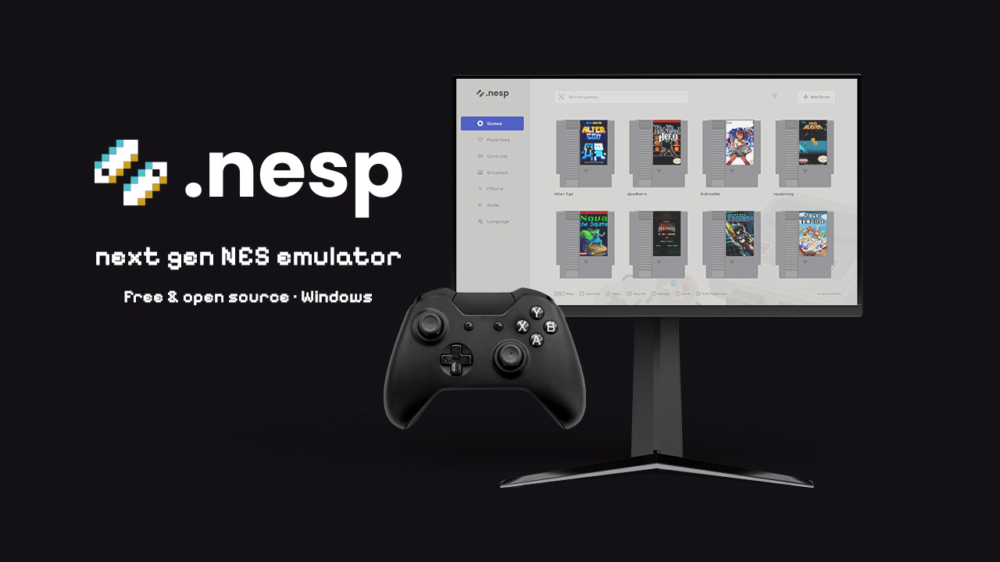
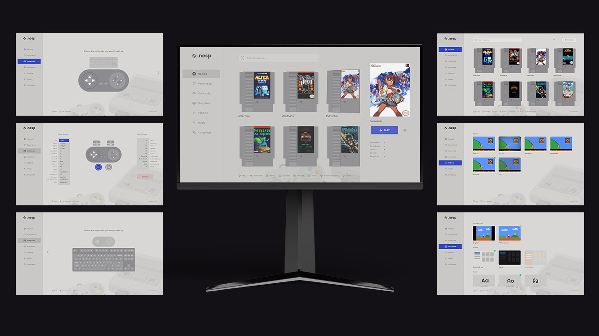

  

  <b>A clean, gamepad-first NES emulator for Windows.</b> 
  Free to use. No ads, no tracking.

  
  

  
  

---

## ✨ Features

- 🎮 **Gamepad-first:** browse your library, open game details and play without touching the keyboard
- 🕹️ **Cartridge library:** every game is a cartridge you slide into the console, with favorites, search and sorting
- 🖼️ **Automatic covers & game info:** covers, publisher, year and genre are found for you; add your own cover with drag and drop
- 💾 **Save & load anywhere** with a single button press, plus turbo buttons and quick restart
- 📺 **Retro filters:** Sharp, CRT TV, Scanlines, Composite, Smooth and LCD
- 🖥️ **Display options:** original aspect ratio or fit to screen, fullscreen or windowed
- 🎨 **Themes & fonts:** Console Gray and Black themes; Poppins, Pixelify Sans and Handjet fonts
- 🎛️ **Controller setup:** remap every button, separately for gamepad and keyboard
- 🌊 **Smooth gameplay:** frames are synced to your monitor's refresh rate
- 🌍 **English & Turkish**
- 🔄 **Automatic updates:** new versions install themselves when you start the app

## 📸 Screenshots

  

## ⬇️ Download

| Version | Description |
|---|---|
| [**Installer**](https://github.com/cumacifci/nesp/releases/latest/download/nesp-win-Setup.exe) | Recommended. Installs Nesp and keeps it up to date automatically. |
| [**Portable**](https://github.com/cumacifci/nesp/releases/latest/download/nesp-win-Portable.zip) | No installation. Unzip and run. Does not update itself. |

**Requirements:** Windows 10 or 11 (64-bit). A gamepad is recommended; Xbox-style controllers work out of the box.

> [!NOTE]
> **Seeing a "Windows protected your PC" warning?**
> Nesp isn't code-signed yet, so Windows SmartScreen shows a warning for new apps.
> Click **More info → Run anyway**. You only need to do this once; updates install without the warning.

## 🚀 Getting started

1. Download and install Nesp.
2. Drag your `.nes` files into the window, or click **Add Game** (**Start** on your controller).
3. Pick a game and press **A** (or **Enter**) to play.

### Default controller layout

| In menus | Action |
|---|---|
| Left stick | Navigate |
| A / B | Play / Back |
| X | Favorite |
| LB | Menu |
| RB | Game details |
| LT | Search |
| RT | Sort |
| Start | Add game |
| Back | Delete game |
| D-pad Up / Down | Fullscreen on / off |

| In game | Action |
|---|---|
| Left stick | Move |
| A / B | A / B |
| X / Y | Turbo A / Turbo B |
| Back / Start | Select / Start |
| RB | Save state |
| LB | Load state |
| D-pad Right | Pause |
| RT | Restart |
| D-pad Up / Down | Fullscreen on / off |
| D-pad Left | Exit game (with confirmation) |

Every button can be changed in **Controls**, separately for gamepad and keyboard.

> 🤫 There may be a little secret hidden somewhere for those who know the old codes…

## ⚠️ Important

Nesp **does not include any games** and does not provide links to download them.
Please only use game files you legally own, or free homebrew games made by the community.

Nesp is an independent project and is not affiliated with, endorsed by or sponsored by Nintendo.
"NES" and "Nintendo Entertainment System" are trademarks of Nintendo.

**Privacy:** Nesp does not collect or send any personal data. It only goes online to look up game covers and information, and to check for updates.

## ☕ Support

Nesp is free and will stay free. If you enjoy it, you can support development:

- ☕ [Buy me a coffee on Gumroad](https://laff.gumroad.com/l/nesp-emulator): every coffee helps keep updates coming
- ⭐ Star this repository so more people can find Nesp
- 🐛 [Report a bug or suggest a feature](https://github.com/cumacifci/nesp/issues)
- 📣 Share Nesp with a friend who misses the good old days

### Supporters

Thank you to everyone who supports Nesp! ❤️

<!-- Add supporter names here -->
*Be the first!*

## 🙏 Thanks

- **Homebrew developers:** the screenshots show free games made by the NES homebrew community, including *Alter Ego* by Shiru, *Nova the Squirrel* by NovaSquirrel and *Super Tilt Bro.* by sgadrat. Thank you for keeping the NES alive. Please support their work!
- **[jsnes](https://github.com/bfirsh/jsnes)** by Ben Firshman and contributors, the emulator core (Apache License 2.0).
- **[libretro](https://www.libretro.com)** databases for game covers and information.
- Fonts **Poppins**, **Pixelify Sans** and **Handjet** (SIL Open Font License).
- Console photos by **Evan-Amos**, Wikimedia Commons (public domain).

---

  Made with ☕ by <a href="https://laff.gumroad.com">Laff.Studio</a>

